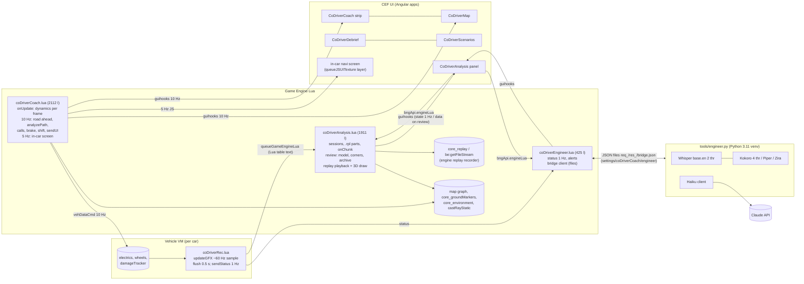

# Co-Driver Coach: project review and roadmap

Written 2026-10-19 (Part A of `docs/archive/NEXT_PHASE_BRIEF.md`). It reviews **main at 43e097e** and the unmerged analysis branch `claude/analysis-upgrade-d4e19c` (4c2f45d). **No production code was changed.**

**Labels:**
- **[verified]**: read in code (file:line) or measured in the game. The measurements are in §3.
- **[hypothesis]**: reasoned, not yet measured.

Companion documents: `docs/EXTERNAL_PROJECT_RESEARCH.md` and `docs/ENGINEER_DATA_ARCHITECTURE.md`.

## 1. Executive assessment
- **Performance:** the FPS loss is mostly **one thing: BeamNG's own replay recorder**, which the analysis starts for every drive.
  - **It costs about 1.7 ms per frame while driving**: about 104 → 88.6 FPS with a fixed camera, or about 15% at that frame rate. Parked, it costs about 1.15 ms (−7%) **[verified, §3]**.
  - **The extensions themselves cost about 0.25–0.4 ms**, the 60 Hz telemetry about 0.1 ms, and the idle engineer bridge nothing.
  - **Whisper and Kokoro only cost while they run:** about 2.2 ms (−12%) for about 1 s per question, and 1–4 s per spoken answer.
  - Together these explain about 2 ms of sustained cost and about 2 ms bursts. The author's "80 → 55" (+5.7 ms) also includes scene differences: the same configuration swung **51–68 FPS** between 30-second windows of AI driving. A repeatable benchmark is defined in §3.4.
- **Architecture:** sound for a one-person mod. There are three GE extensions, one vehicle extension, five Angular apps and a file-based bridge. The main weaknesses:
  - **Code concentration:** `coDriverCoach.lua` has 2,112 lines at **193 of the 200** top-level locals.
  - **Settings scattered** across four stores with no UI for most of them.
  - **Session-only analysis** with no notion of laps.
  - **Context-push to Haiku** (the whole analysis on every review question).
  - **Repeated "bugs from the platform":** replay corruption (still 1 in 10 file switches on the branch), stale CEF UI caches, and Haiku's default thinking eating the token budget.
- **Biggest wins, in order:**
  1. **Make the `.rpl` recorder optional or smarter.** Off by default and turned on per session, or record only while a lap is in progress. That recovers about 1.7 ms immediately.
  2. **Run Whisper and Kokoro at lower priority**, and keep the voice to the analysis by default (already the case).
  3. **A settings panel** covering the 14 console-only options.
  4. **Engineer tools** instead of context-push.
  5. **Lap recognition, then lap-based analysis.**

## 2. Current architecture

### 2.1 Dependency map
| Module | Depends on | Depended on by |
|---|---|---|
| `coDriverCoach.lua` | map, core_groundMarkers, core_camera, core_vehicles, freeroam, Engine.Audio, guihooks, the voicepack; optionally `coDriverAnalysis` (`isRecording`) | Analysis (`isEnabled`, `getGrip`, `dismissSummary`, `getDebugState`), Engineer (`getDebugState`, `getGrip`, `isEnabled`), all UI apps |
| `coDriverAnalysis.lua` | core_replay, `be:getFileStream`, map, castRayStatic, debugDrawer, FS/json, `coDriverCoach`; vehicle `coDriverRec` (chunks, car info) | the panel app, the Debrief app (`review`/`keepRecording`), Engineer (`getResult`, `isOpen`) |
| `coDriverEngineer.lua` | core_environment, `coDriverCoach`, `coDriverAnalysis`, vehicle `coDriverRec.sendStatus`, the bridge's files | the panel app (engineer bar), hotkeys |
| `coDriverRec.lua` (vehicle) | electrics, wheels, powertrain, damageTracker, particles | Analysis (`onChunk`, `onCarInfo`), Engineer (`onStatus`) |
| `tools/engineer.py` | the venv (faster-whisper, kokoro-onnx, piper, sounddevice), the PowerShell speech helper, Claude API | the game, through files |

**Coupling notes:**
- The three GE extensions call each other through **globals** (`coDriverCoach.x`) guarded by `if coDriverX then` **[verified]**. That's simple and robust to load order.
- Analysis and Engineer both reach into the coach's debug state, which is an informal API surface **[verified, `coDriverEngineer.lua:240` `driveContext`]**.

## 3. Performance investigation (measured 2026-10-19)

**Setup:**
- Ryzen 7 5800X (8 cores, 16 threads), 32 GB RAM, RTX 3080.
- 3440×1417 window, vsync off, frame limiter off (`fpsLimitEnabled=false`) **[verified]**.
- West Coast USA, Vivace, driver camera unless noted.

**Probe:** a temporary GE extension recorded each frame's `dtReal`. The extensions were loaded and unloaded between windows. Each window was 20–30 s, mostly run twice in alternating order. The probe was deleted afterwards.

### 3.1 Results
| # | Configuration | FPS | avg ms | p95 ms | Δ vs baseline |
|---|---|---|---|---|---|
| S0 | Parked, driver camera, **no mod extensions** | 66.2–66.3 | 15.08 | 15.6 | — |
| S1 | + coach | 64.9–65.3 | 15.3–15.4 | 15.8 | +0.25 ms |
| S2 | + analysis (idle) | 64.9–65.4 | 15.3–15.4 | 15.5–16.0 | ≈ S1 |
| S3 | + engineer (bridge off) | 64.8–65.3 | 15.3–15.4 | 15.6–16.1 | ≈ S1 (+0.25–0.3 ms total) |
| S4/S5 | In-car console map off / on | 65.5–65.9 / 64.9–65.4 | 15.2 / 15.3–15.4 | — | ≈ +0.1 ms (inside the noise) |
| B1 | + bridge running, idle (models loaded) | 64.9 | 15.41 | 15.75 | 0 (bridge 0.12% CPU, 547 MB RAM, 28 threads) |
| B2/B3 | During one spoken line / 20 s after | 63.2 / 65.0 | 15.82 / 15.38 | 17.9 / 15.8 | burst only; no lingering cost |
| B4/B5 | During one transcription / 20 s after | 64.2 / 64.7 | 15.57 / 15.45 | 16.4 / 15.8 | burst only |
| S6 | **Whisper transcribing non-stop** (2 threads) | 56.9 | 17.58 | 18.7 | **+2.2 ms** while active |
| S7 | **Kokoro synthesising non-stop** (4 threads) | 57.1 | 17.52 | 19.1 | **+2.1 ms** while active |
| R0 | Parked, nothing recording | 64.5–64.6 | 15.49 | 16.1 | — |
| R1 | Parked, **.rpl replay recording** | 59.9–60.2 | 16.62–16.69 | 17.0–17.4 | **+1.15 ms** |
| R2 | Parked, 60 Hz telemetry sampler | 64.6–64.8 | 15.44–15.47 | 16.0 | ≈ 0 |
| D0–D2 | AI driving, driver camera, vanilla / coach+engineer / full | 51–68 (same configuration varies ±15%) | — | — | **unusable: scenery dominates** |
| F0 | AI driving, **fixed camera**, vanilla | 108.4–108.7 | 9.2 | 9.6–9.9 | — |
| F1/G1 | AI driving, fixed camera, coach+engineer | 103.2–106.7 | 9.4–9.7 | 9.9–10.5 | +0.2–0.45 ms |
| G3 | AI driving, fixed camera, + 60 Hz telemetry (`.rpl` stopped) | 102.3–105.9 | 9.45–9.77 | 10.0–10.5 | ≈ +0.1 ms over G1 |
| G2 | AI driving, fixed camera, **+ `.rpl` recording** | 88.1–89.0 | 11.23–11.35 | 11.6–11.9 | **+1.6–1.7 ms over G3** |

No frame went over 25 ms in any window. The cost is sustained per-frame time, not hitches, except during inference bursts.

### 3.2 Component cost breakdown
| Component | Sustained cost | Bursts | Evidence |
|---|---|---|---|
| Engine `.rpl` replay recorder (started by `coDriverAnalysis.lua:108`) | **+1.15 ms parked, +1.7 ms driving** | — | R1, G2 |
| Coach (10 Hz road analysis, calls, UI push 10 Hz, screen 5 Hz) | about +0.25 ms | — | S1, F1 |
| Analysis while idle or recording telemetry (onChunk every 0.5 s) | ≈ 0–0.1 ms | — | S2, G3 |
| Engineer (1 Hz status, 2 s bridge check) | ≈ 0 | — | S3 |
| In-car console map (5 Hz HTML texture) | ≤ 0.1 ms | — | S4/S5 |
| Bridge idle | 0 | — | B1, B3, B5 |
| Whisper transcription | 0 | +2.2 ms for about 1 s per question | S6, B4 |
| Kokoro speech | 0 | +2.1 ms for about 0.3 s per sentence, while speaking | S7, B2 |

### 3.3 Root causes and gaps
1. **The `.rpl` recorder is the regression [verified].** It serialises all car state every frame on the main thread **[hypothesis about why; the cost is measured]**. It came in with the analysis, around the same time as the engineer, which explains why it was blamed on the engineer.
2. **Inference CPU contention [verified]:** the 5800X has 8 cores, but the game's main and physics threads contend with 2–4 inference threads. Raising their priority isn't possible, so **lower the bridge's process priority** (BELOW_NORMAL) **[hypothesis: should cut the burst cost]** and keep `tts_threads` at 2–3.
3. **Not measured:**
   - Session save at drive end: `saveSession` with up to 162k samples as JSON, plus archive writes. Probably a one-off hitch of hundreds of ms at the end of a long drive **[hypothesis]**.
   - The review payload: a 1.6–2.6 MB `guihooks` push on long drives **[estimate from the branch]**.
   - Stale UIs in other cars.
   - Memory growth over a 45-minute session: Lua heap about 175–195 MB throughout the tests **[verified only for short sessions]**.
4. **The author's 80 FPS baseline can't be reproduced** without their scene. This spot runs at **66 FPS without the mod**.

### 3.4 Reproducible benchmark (for validating fixes)
1. Load West Coast USA, Vivace, and teleport to (−315.2, −794.0, 137.2) with rotation (−0.0091, −0.0029, 0.3694, 0.9292).
2. **Fixed free camera** at (−315, −794, 400) looking up, so rendering stays constant.
3. AI `span` mode, aggression 0.5; verify speed > 5 m/s before each window.
4. Alternate configurations in 20 s windows, three rounds each.
5. The probe and procedure are in this section. The script lived in `%TEMP%\cdc_tests\perf.sh` and is worth adding as `tools/perf_bench.sh`.
6. **Targets:**
   - recording on ≤ +0.3 ms over G1
   - full mod ≤ +0.5 ms over vanilla
   - inference bursts ≤ +1 ms

### 3.5 Ranked optimisations
| Rank | Change | Expected benefit | Effort | Risk |
|---|---|---|---|---|
| 1 | `.rpl` recording **off by default**; a "record replay" toggle, or **record only during laps and stages**, or an automatic pause when FPS headroom is low | −1.7 ms while driving | S | Corner replays only for sessions that opted in |
| 2 | Bridge process at BELOW_NORMAL priority; `tts_threads` 2–3; Whisper `beam_size` 1 for drive mode | about −1 ms in bursts **[hypothesis]** | S | Slightly slower answers |
| 3 | Write the session save off the critical path: chunked, incremental appends during the drive (string.buffer), as BeamNG's own `telemetry/core.lua` does | no end-of-drive hitch | M | File format change (with migration) |
| 4 | Coach: compute `buildView()` once per 100 ms and reuse it for the screen (`coDriverCoach.lua:1484` and `:1534`); cache unit settings | about −0.05 ms | S | None |
| 5 | Adaptive telemetry: 30 Hz on straights, 60 Hz in corners and braking | memory −40% | M | Analysis assumes a roughly uniform rate (it resamples by distance, so it's fine) |

## 4. Defects and technical debt register
| ID | Severity | Component | Finding | Evidence |
|---|---|---|---|---|
| D1 | **High** | Analysis / replay | `.rpl` recording costs about 1.7 ms per frame for every drive | §3 G2/R1; `coDriverAnalysis.lua:108` |
| D2 | **High** | Analysis / replay | Replay files corrupt at rotation ("Couldn't read last packet"). The branch makes it rarer (1 in 10) but doesn't fix it | beamng.log 2026-10-18 22277 s; branch note 4c2f45d |
| D3 | **High** | Analysis | Cleaning up old replays deleted the author's newest real-drive replays when AI test sessions were added (fixed on the branch: keeps the 2 newest sessions) | branch note |
| D4 | Medium | Analysis | After 45 minutes, every 0.5 s chunk shifts the whole 162k-entry sample array (O(n) copy) | `coDriverAnalysis.lua:214-217` |
| D5 | Medium | Analysis | Each sample is its own Lua table (about 20 numbers): heap churn and GC on long drives | `onChunk` `:192` |
| D6 | Medium | Coach | 193 of 200 top-level locals; new code has to go in `do` blocks | lint `count.js`; ROADMAP §5 |
| D7 | Medium | Coach / Engineer | One shared `errorLogged` flag hides every error after the first | `coDriverCoach.lua:1662,1675` |
| D8 | Medium | Vehicle recorder | The damageTracker callback is registered again on every extension reload (duplicates) | `coDriverRec.lua:134-135` |
| D9 | Medium | Settings | 14 coach options are console-only (`voiceVolume`, `callAheadSec`, `consoleMap`, `chatter`, `distanceCalls`, `crests`, `brakeVoice`, `carControl`, `frameScreen`, `toasts`, `voiceOutput`, voicepack…) | `coDriverCoach.lua` defaults; the strip only exposes on/voice/surface/style/end |
| D10 | Medium | UI | CEF serves a stale cached app after a game restart. deploy.sh now hard-reloads, but users installing a zip get no reload | 2026-10-18 incident |
| D11 | Medium | Engineer | The review context embeds the whole analysis in the system prompt on every question (about 15–25 KB) | `coDriverEngineer.lua:262` `reviewContext`; `engineer.py` `answer()` |
| D12 | Low | Engineer | Haiku 5.5 default thinking can return empty text under small budgets (fixed for radio by disabling it; review mode still uses default thinking with 350 tokens) | `engineer.py` `haiku()` |
| D13 | Low | Engineer | Tyre temperature is only judged "not simulated" by comparing with air temperature (a heuristic) | `engineer.py` `tyre_temp_simulated` |
| D14 | Low | Bridge | It polls the folder every 50 ms and rewrites `bridge.json` every second, even with the game closed | `engineer.py:670-680` |
| D15 | Low | Analysis | Corner ids are per session, not per place, so they can't be compared across laps or sessions | analysis result schema |
| D16 | Low | Architecture | Extensions read each other's debug state (`getDebugState`) as an API | `coDriverEngineer.lua:240` |
| D17 | Low | Data | Four settings stores: coach JSON, analysis JSON, engineer JSON, bridge JSON | §6 |

## 5. Feature designs

### 5.1 Automatic lap and route recognition (Phase 3, design only)
**Matching method: driven-geometry matching, with the road graph only as a helper.**
- Graph node ids differ per lane and junction, and GPS isn't needed because world coordinates are exact.
- This follows ghost-racer-telemetry's projection (MIT) and Ghost Racer Enhanced's gate rules (idea only). See `EXTERNAL_PROJECT_RESEARCH.md` §3.

**Algorithm (GE, 10 Hz, about microseconds per tick [hypothesis]):**
1. **Breadcrumbs:** keep the driven path every 4 m (`x, y, z`, heading from the path tangent over 12 m, time, cumulative distance) in a spatial hash with 25 m cells. Reuse the analysis session's samples.
2. **Return candidate:** the current position is within **8 m laterally** of a breadcrumb that is **≥ 60 s and ≥ 600 m older**, heading within **30°** (same direction), and height within **4 m** (rejects overpasses).
3. **Confirmation (avoids junctions and crossings):** the match must **continue for ≥ 150 m**, with the station along the old path increasing monotonically. A crossing road gives only a momentary match with the wrong heading; a shared stretch of a figure-8 ends early.
4. **Route creation:**
   - The polyline from the first matched breadcrumb to the point where the loop closed becomes a **closed route**.
   - The start gate goes at the match point: position, normal from the tangent, half-width from road radius + 2 m.
   - Checkpoints every 100 m; corners from the analysis' corner finder on that polyline (stable ids).
   - Minimum length **800 m**, minimum duration **40 s**.
5. **Laps:**
   - **Start:** crossing the gate inside a bounded box (half-width × −1..3.5 m height), with direction checked against the **route tangent** (not just the gate normal, the fix for Ghost Racer's Tsukuba issue) and a 3 s debounce.
   - **Valid lap:** the next gate crossing, with ≥ 90% of checkpoints passed in order, no teleport or reset, and length within ±15% of the route.
6. **Deviation:**
   - **Invalid:** more than **max(12 m, road half-width + 6 m)** from the route for more than **3 s or 150 m**. The partial lap is kept, labelled with the reason.
   - **Rejoin:** back within 8 m, same heading, and station ahead of the last valid one. Timing continues as "invalid" until the next gate, then a new valid lap starts.
7. **Point to point:**
   - **Automatic:** after a reset or teleport to within 30 m of the start of an earlier run, the same path followed for ≥ 70% of checkpoints suggests a P2P route. The start goes where speed rose above 3 m/s; the finish where the earlier run ended.
   - **Manual:** "set start here" / "set finish here" in the panel or by hotkey, like Ghost Racer Enhanced.
8. **Discovery mode:** a setting with `auto` / `confirm` (default: a toast "Route found, 2.5 km. Time laps? [Yes]") / `off`.
   - Routes are saved per level in `routes/<level>.json` (schema in `ENGINEER_DATA_ARCHITECTURE.md` §4).
   - Official quick race and time trial layouts can be preloaded as `source: official`.

**Edge cases:**

| Case | Handling |
|---|---|
| Overpass | Height check |
| Out-and-back on the same road | Heading check: the reverse direction is a different route |
| Parallel lanes | 8 m tolerance |
| Spin near the gate | Debounce and monotonic station |
| Car switch, level change | End the lap and keep the partial |
| Pause | The clock follows `dtSim`, so pauses don't count |
| Repeated short loops (a roundabout) | Minimum length and duration |

### 5.2 Lap-based analysis (Phase 4)
- **Per lap:** run the existing model (`betterLine`, `idealSpeeds`, corners) on the **route polyline grid** so all laps share stations and corner ids (fixes D15). The reference for the better line is the route centreline, or the best lap.
- **Alignment:** project every lap onto the reference lap (port of `stationsFor`, MIT), then compute Δ(s), 10 m mini-sectors and stretches ranked by rate, and the ideal lap from the best cells.
- **Scopes:** `session` (today's view) / `best` / `latest` / `lap N` / `compare A vs B`.
  - One `scope` object drives the map traces, charts, corner list and replay range (a lap's `t0..t1`).
  - The corner list shows a CornerPass per lap, with best-pass markers.
- **Data:** laps stored inside the session file (`laps: [...]`, schema §4 of the data document). Old sessions show "session" scope only. Laps can be rebuilt offline from saved samples once routes exist (migration).
- **UI:** a lap strip under the header (L1 1:24.3, L2 1:23.6 ★, L3 1:23.9). Click to select; shift-click to compare. Sector times appear as a small table.

### 5.3 Visual braking aid (Phase 5)
**Recommendation:** Mode A on the **coach strip**, plus a tick on the **minimap**. Mode B is optional in 3D. The default remains Mode C.
- **Mode A, braking bar:** a slim bar under the next call that fills as the car nears the brake point.
  - It reuses the coach's existing brake state and target (`brake.state`, `brake.target`, the next note's `dist`/`vSafe`, already in `sendUI`).
  - **Grey:** more than 3 s away. **Amber:** prepare (under about 2 s). **Red:** brake now, with the target speed.
  - Consecutive corners show only the next one; the bar resets when the next note takes over.
  - Cost: none beyond today's 10 Hz UI update.
- **Minimap tick:** a short line across the road at the brake point (one more draw call in `CoDriverMap`).
- **Mode B, 3D zone:** a translucent strip on the road from the brake point to the target-speed point, for the next corner only, drawn with `debugDrawer:drawSquarePrism` (as the replay ribbons are).
  - Cost: a few prisms per frame **[hypothesis: well under 0.1 ms; the replay's longer ribbons showed no visible cost]**.
  - Optional, because it's the most intrusive.
- **Settings:** `brakeAid = off | bar | bar+zone`. It respects the surface and learned grip automatically, since it reads the same brake model.

### 5.4 UI and settings audit (Phase 6)
**Inventory (verified in code):**

| Setting | Stored in | UI | Hotkey | Console |
|---|---|---|---|---|
| enabled, voice, surface, style | coach JSON | ✅ strip | ✅ toggle/voice/surface | ✅ |
| voicepack, voiceOutput, voiceVolume | coach JSON | ❌ | ❌ | ✅ `setOption`/`cycleVoicepack` |
| callAheadSec, distanceCalls, crests, brakeVoice, carControl, chatter, toasts | coach JSON | ❌ | ❌ | ✅ `setOption` |
| consoleMap, frameScreen | coach JSON | ❌ | ❌ | ✅ `setOption` |
| scenario, own car, stage km | coach JSON | ✅ scenarios menu | ✅ menu/restart | ✅ |
| analysis margin, style | analysis JSON | ✅ panel "model"/settings | ❌ | ✅ `setOption` |
| `.rpl` recording, replay window | constants (`PART_SECS`, `REPLAY_WINDOW`) | ❌ | ❌ | ❌ |
| engineer alerts, speak, speakDrive | engineer JSON | ✅ panel engineer settings | ✅ talk / status | ✅ |
| voice, style, speed, threads, prompts | bridge JSON (`tools/engineer_config.json`) | ❌ (text file) | ❌ | ❌ |

**Findings:**
- 14 coach options are console-only (D9).
- Replay recording isn't configurable at all, though it's the main FPS cost.
- The bridge voice and style can't be changed in game.
- "Back to the full map": the panel's **whole drive** button is on the map, but the new map-first layout and corner selection can zoom away from it, and the coach strip has no map shortcut **[verified layout; the author reports it's not discoverable]**.

**Proposal:** one **Settings** tab in the analysis panel (reachable from the strip's new ⚙ button), grouped as:
1. **Co-driver and navigation:** style, call timing, distance calls, crests, surface, console map, screen framing.
2. **Voice and audio:** voicepack, output, volume, chatter, toasts.
3. **Driving assistance:** brake cues (voice), car control, braking aid (bar/zone).
4. **Race engineer:** alerts, voice in analysis, voice while driving, persona, voice and speed. Bridge-side values get written to the bridge config through a `config` request to the bridge.
5. **Recording and analysis:** record replay (off / laps only / always), replay window, margin, style, route discovery.
6. **Performance and advanced:** telemetry rate, Whisper threads, TTS threads, diagnostics.

Keep the compact strip. Add a persistent **map** button on the strip (opens the panel on the whole-drive map) and keep **whole drive** fixed in the map corner. Settings persist in the existing JSON files; the bridge keeps its own file.

### 5.5 Haiku engineer optimisation (Phase 7)
Detailed in `docs/ENGINEER_DATA_ARCHITECTURE.md`. In summary:
- **Deterministic first:** simple status, radio checks and alerts never call the LLM.
- **Bounded tools:** about 10 tools, each returning ≤1.5 KB, for live, events and analysis tiers. No raw telemetry, and the analysis is no longer in the system prompt (fixes D11).
- **Memory:** radio 3 minutes; review per scope; a profile file for long-term habits.
- **Reliability:**
  - freshness stamps (stale over 3 s)
  - a confidence label per value (measured, estimated, unavailable)
  - a "no number that wasn't provided" check
  - 6 s timeout in drive mode, then the template answer
- **Thinking:** disabled in drive mode; a small explicit budget in review mode (fixes D12).
- **Measured latency** (2026-10-18 tests): drive answers 0.7–2.0 s, review answers 0.9–1.9 s, with thinking disabled for drive mode **[verified, test logs in the session]**.
- **Token use:**
  - Drive requests are about 1–1.5k input tokens **[estimate]**.
  - Review requests carry the whole analysis, about 5–8k input tokens **[estimate]**, which tools should cut to about 1.5–3k.
  - Log real usage to `engineer/usage.jsonl` before quoting costs; prices aren't assumed here.

## 6. Prioritised roadmap

| # | Priority | Component | Problem | Evidence | Solution | Benefit | Risk | Validation |
|---|---|---|---|---|---|---|---|---|
| 1 | **Critical** | Analysis / replay | `.rpl` recorder costs 1.7 ms per frame for every drive | §3 G2, R1 | Setting `recordReplay = off / laps / always` (default **laps** once laps exist, **off** until then); pause recording when parked (exists) | +15% FPS while driving | Fewer replays | Benchmark §3.4: G2 ≈ G3 when off |
| 2 | **High** | Bridge | Inference bursts cost about 2.2 ms | §3 S6, S7 | BELOW_NORMAL priority; `tts_threads` 2; Whisper `beam_size` 1 for drive mode | Smaller bursts | Slightly slower answers | Rerun S6/S7 with the priority set |
| 3 | **High** | Replay | Rotation corruption (1 in 10 on the branch) | log; branch note | Prefer **no rotation**: one file per lap or stage (laps make files short); otherwise keep the wait-for-inactive logic | No corrupt replays | Larger single files | 20 rotations without a corrupt file |
| 4 | **High** | UI and settings | 14 console-only options; map not discoverable | §5.4, D9 | Settings tab + strip ⚙ and map buttons | Usable without the console | UI regressions | Checklist: every inventory row reachable and persisting |
| 5 | **High** | Analysis (branch) | Merge the incident handling, replay fixes and replay-cleanup safety | branch 4c2f45d | Review and merge after the author OKs it | Correct coaching | Merge conflicts (low) | Offline tests + a live replay |
| 6 | High | Engineer | Whole analysis in the system prompt; thinking defaults in review mode | D11, D12 | Tools + `live.json`/`analysis.json` snapshots; review thinking budget | Lower latency and tokens; fewer hallucinations | Tool-loop bugs | Usage log: tokens per review down ≥ 50%; no invented numbers in 30 test questions |
| 7 | High | Engineer | Simple questions still call the LLM | §6 of the data document | Local intent routing to templates | About 50% fewer calls **[hypothesis]** | Template coverage | Question log |
| 8 | Medium | Laps | No repeatable laps in free roam | §5.1 | Route discovery + gate + checkpoints | Enables laps, sectors, comparisons | False laps | Test set: loop, figure-8, out-and-back, overpass, junction, P2P (≥ 95% correct) |
| 9 | Medium | Analysis | Session-only scope; corner ids per session | D15 | Lap scopes, projection, mini-sectors (MIT port) | Clear comparisons | Panel complexity | Two-lap compare on recorded laps; Δ matches the lap-time difference within 0.05 s |
| 10 | Medium | Assistance | No visual brake aid | §5.3 | Strip bar + map tick; optional 3D zone | Learning roads | Clutter | Frame-time check with the 3D zone on |
| 11 | Medium | Data | Session save blocks at drive end; O(n) shift after 45 min | D4, D5, §3.3 | Incremental append writer; ring buffer | No end-of-drive hitch | Format migration | Measure the save time on a 30-minute session before and after |
| 12 | Low | Coach | 193/200 locals; 2.1k-line file | D6 | Split into modules (voice, road, review, scenarios, screen) behind the same `M` API | Maintainability | Load-order bugs | All features smoke-tested; lint clean |
| 13 | Low | Robustness | Shared `errorLogged`; duplicate damage callback | D7, D8 | Per-subsystem error logging with rate limits; register once | Debuggability | None | Inject errors in two subsystems; both get logged |
| 14 | Low | Bridge | Polls and writes when the game is closed | D14 | Back off to 1 s polling when `bridge.json` hasn't been read for 30 s | Less disk churn | None | Process CPU idle |
| 15 | Low | Extras | Ideas from research: balance-coloured line, measured power, official routes, recce notes | research doc §3 | As listed | Richer analysis | — | Per feature |

## 7. Test and validation plan
- **Static checks on every change:** Lua lint (`%TEMP%\cdclint` `c.js`, `count.js`), JS syntax, Python `ast.parse`.
- **Offline tests (`tools/offline`, fengari):**
  - existing: walls, slope, archive, replay state machine
  - new: route discovery (synthetic loop, figure-8, out-and-back, overpass, junction), lap timing and invalidation, projection and mini-sectors against hand-computed values, scope switching
- **Performance:** the §3.4 benchmark before and after each performance change. Record FPS, p95, p99 and frames over 25 ms. Pass thresholds are in §3.4.
- **Live smoke test after deploy:**
  1. strip, map, debrief and scenario menu render; the panel opens a session and plays a replay across a file boundary
  2. the engineer answers a status question offline and with Haiku
  3. settings persist across a game restart
  4. **hard UI reload** before checking (avoids stale caches)
- **Engineer quality:** a fixed 30-question set (drive and review, including garbled input). Check:
  - word limits
  - no invented numbers (automatic check)
  - tyre-temperature honesty
  - repetition
  - latency, tokens and fallbacks, from `usage.jsonl`
- **Data migration:** load every format 1 and format 2 session in `sessions/` after any schema change; old sessions open in "session" scope with no errors.
- **Regression guard:** for scenarios, navigation and co-driver calls, drive one scenario stage with voice on and check calls, brake cues and the stage finish after any change to coach code.

## 8. Phase results (2026-10-19, approved changes)

### 8.1 Replay recording modes (implemented)
- **Setting:** `recordReplay` = `off` / `laps` / `always`, **default `laps`**. It's in the analysis panel's settings and in `settings/coDriverCoach/analysis_settings.json`. Telemetry records in every mode.
- **`laps` before automatic lap recognition:** the replay records only during a **scenario GPS stage**, or a drive the author **arms** with the "record replay for this drive" hotkey (`coDriverAnalysis.armReplay()`). Lap recognition will become the third trigger.
- **Verified live:**
  - `off`: 792 telemetry samples, no replay file.
  - `laps`, nothing armed: telemetry only.
  - Arming mid-drive starts the replay within a second.
  - A stage starting or ending (simulated by swapping `coDriverCoach.isStageActive`) starts or stops it.
  - Switching mode mid-drive stops or starts the replay without affecting telemetry.
- **No automatic deletion:**
  - Replay files and archived sessions are never deleted by the mod (the 20-minute replay window and the 20-session archive limit are gone).
  - The panel shows how many replay files are kept.
  - The offline archive test checks 23 of 23 sessions kept.

### 8.2 Replay corruption investigation
- **Reproduction attempts, 37 recordings, all readable:**
  - 10 stop-wait-start rotations
  - 10 same-frame rotations
  - pause mid-recording, stop while paused, car reset, teleport, load-while-recording
  - one 5-minute, 266 MB file
  - 11 rotations through the mod's own code (20 s parts)
  - 10 replay handovers loading the next file while one plays
- **The game log shows only 2 corrupt files ever:**
  - `205018`: the author's run, cut by the mod's 5-minute rotation on main.
  - `223909`: cut by the branch's test rotation, and failing during a continuous-replay handover.
- **What they share:** both are non-final parts cut by the mod's **timed rotation**, and both were first loaded while the replay engine was busy.
- **The engine-level cause wasn't reproduced.**
- **Fix, removing the common factor and adding resilience:**
  1. Timed rotation is **off** (it existed to delete old parts, which no longer happens). A file now ends only when recording pauses or the mode stops wanting it.
  2. The continuous-replay handover now **stops playback, waits for the engine to go idle, then loads**, instead of loading at end of file.
  3. A failed load is **retried once** after the engine is idle before the file counts as damaged.
  4. Damaged files are skipped with a note (from the branch).
- **Offline tests:** normal 3-file playback; damaged middle file retried once, then skipped.

### 8.3 Fixed-route benchmark (`tools/perf_bench.sh` + `tools/bench/cdcBench.lua`)
The AI drives waypoints from the author's 3-lap forest session, from the same start, every run. The camera is fixed (constant rendering) or the driver camera. Each configuration runs 25 s, alternating.

| Camera | Replay | FPS (runs) | avg ms | p95 ms | p99 ms | frames > 20 ms per 25 s |
|---|---|---|---|---|---|---|
| fixed | off | 102.3 / 102.1 / 102.1 | 9.78 | 10.4–10.7 | 10.7–11.3 | 0 |
| fixed | always | 85.8 / 85.9 / 85.7 | 11.65 | 12.2–12.5 | 12.8–12.9 | 0 |
| driver | off | 60.4 / 59.9 | 16.6 | 18.8–19.0 | 19.2–20.1 | 0–19 |
| driver | always | 56.1 / 55.5 | 17.9 | 20.1–20.6 | 20.4–20.8 | 94–131 |

**Replay recording costs +1.87 ms per frame with the fixed camera (−16%) and +1.3 ms with the driver camera (−7%)**, and makes frames over 20 ms 5–7× more frequent. With `laps` mode, normal free driving no longer pays this.

**Update 2026-10-20, BeamNG 0.40.1** (same route and procedure, default Vivace config): fixed camera about 210 FPS off and on (+0.12 / −0.03 ms), driver camera 73.0 vs 72.4 FPS (about +0.1 ms), no frames over 20 ms in either. The recorder cost is gone; replay files are about 33 MB a minute.

### 8.4 Speech spikes and bridge priority
- **Priority:** the bridge (`tools/engineer.py`) now sets itself and its speech helper to **BelowNormal** (`priority` in the bridge config; a 64-bit handle bug in the first version was fixed, and the PriorityClass was checked with PowerShell).
- **Benchmark** (fixed route, fixed camera, replay off, two rounds):

| Load | Priority | FPS | avg ms | p95 ms |
|---|---|---|---|---|
| quiet | — | 103.4–105.0 | 9.5–9.7 | 10.2–10.4 |
| Kokoro speaking every 4 s (through the bridge) | below normal | 94.1–95.4 | 10.5–10.6 | 13.1–13.2 |
| Kokoro speaking every 4 s | normal | 94.7–95.3 | 10.5–10.6 | 13.1–13.3 |
| Whisper transcribing non-stop (worst case) | below normal | 85.5–85.7 | 11.7 | 12.8–13.0 |
| Whisper transcribing non-stop | normal | 84.4–85.3 | 11.7–11.9 | 12.9–13.2 |
| Kokoro, pinned to CPUs 12–15 | default | 95.2–95.5 | 10.5 | 12.2–12.4 |

- **Priority makes no measurable difference.** With 16 logical CPUs the game isn't starved of CPU time; the cost comes from shared resources (boost clocks, cache and memory bandwidth, SMT siblings) **[hypothesis]**.
- **Pinning to 4 CPUs** trims p95 slightly (about 0.5 ms) but not the average: marginal, so not adopted.
- **Remaining levers [hypotheses to test]:** fewer TTS threads (4 → 2), Whisper `beam_size` 1 in drive mode, and keeping the voice to the analysis (already the default).
